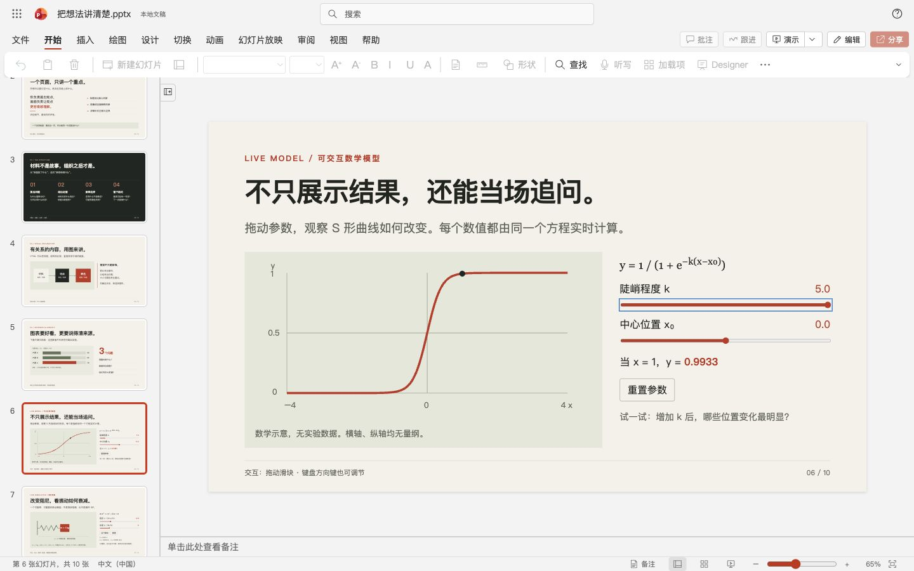

# html-in-PPT

**HTML 负责演讲和交互；PPTX 负责提交和静态备用。**

把课程材料、项目仓库或实验结果交给 agent，让它按 `html-deck` skill 制作 HTML 幻灯片和逐页讲稿。演讲时主窗口看稿、控场，观众窗口只显示幻灯片和交互；需要提交时，一条命令生成带可编辑原生备注的截图式 PPTX，并打包 HTML 与使用说明。放映 PPTX 时点击第一页，可打开交互版。

适合课堂 pre、课程项目汇报和答辩。**PPTX 每页是一张截图，不能逐项编辑文字和图表；需要提交可编辑源文件的作业请先确认要求。**



[上台演讲](#我想上台讲) · [生成 PPTX](#我需要老师要求的-pptx) · [安装 skill](#安装为-skill) · [导出说明](references/pptx-export.md) · [放映指南](references/presenting.md)

## 能做什么

- **按自己的节奏讲。** 点击或按方向键逐步展开内容，再翻页；支持撤回步骤、概览和指定页跳转。
- **现场操作模型。** 实时函数图表、可暂停的阻尼弹簧、可拖动的 CSS 3D 示例，可按主题替换。
- **一份讲稿，两处使用。** HTML 的逐页 `speaker-note` 同时用于演讲者控制台和 PPTX 原生备注，支持段落、要点与操作提示。
- **同时交付两种文件。** HTML 保留交互，PPTX 保留每页静态画面和可编辑备注；ZIP 中附带两份文件和使用说明。

界面参考 PowerPoint 网页版。内容由 agent 改写 HTML，没有拖拽编辑、云端保存或协作；未实现的编辑按钮置灰。页面显示 `.pptx` 文稿名，实际 HTML 下载仍使用 `.html` 扩展名。

## 我想上台讲

### 1. 先看效果

[下载仓库 ZIP](https://github.com/Silhouette-my/html-in-PPT/archive/refs/heads/main.zip)，解压后双击 `assets/deck-template.html`。看示例不需要安装 Node.js、Python 或启动服务器。

10 页示例中，第 2–3 页展示逐步讲解，第 6 页可调整函数参数，第 7 页是弹簧模拟，第 8 页可旋转三维模型。点击“演示”后，主窗口成为演讲者控制台，可查看当前页、下一页预览、讲稿、计时和导航；观众窗口只显示幻灯片。把观众窗口拖到投影屏并全屏，只共享该窗口。双击打开 HTML 即可单屏使用，无需先启动服务器；按 Esc 返回工作区。

## 我需要老师要求的 PPTX

### 1. 把材料和 skill 交给 agent

不必先安装成全局技能。让有本地文件与命令执行权限的 agent 访问本仓库和你的材料，然后发送：

> 请先阅读这个仓库的 SKILL.md，按 html-deck 流程，根据我提供的项目和实验结果制作一个 8 分钟中文 pre。受众是同班同学，重点讲问题、实现思路和结果。请生成 HTML 幻灯片和逐页讲稿，并完成带备注的 PPTX、配套 HTML 和 ZIP。资料：……

agent 负责内容、视觉设计和讲稿；模板负责放映交互，脚本负责自动导出。仅粘贴 GitHub 链接并不能给没有文件或执行工具的聊天模型增加这些能力。

### 2. 一条命令导出

要求 Node.js 22+，推荐 **22 或 24 LTS**，在仓库根目录首次执行：

```bash
npm ci
npm run browser:install
npm run doctor
```

`npm run browser:install` 下载失败时，可以显式复用系统已安装的 Chrome（`chrome`）或 Edge（`msedge`）。macOS / Bash 示例：

```bash
HTML_DECK_BROWSER_CHANNEL=chrome npm run doctor
HTML_DECK_BROWSER_CHANNEL=chrome npm run export -- --html "presentation.html" --output-dir "delivery"
```

Windows PowerShell 的设置方式及排错见 [系统浏览器用法](references/pptx-export.md#下载受限时使用系统-chrome--edge)。

agent 完成 `presentation.html` 后执行：

```bash
npm run export -- --html "presentation.html" --output-dir "delivery"
```

也可以直接用 `assets/deck-template.html` 作为输入，试跑完整流程。`delivery` 必须是尚不存在的新目录。反复修改可用 `--auto-version "delivery"` 替代 `--output-dir`，自动分配 `delivery-001` 等新目录。Windows 和 macOS 命令相同，路径含空格时加引号。

```text
delivery/
  presentation.html
  presentation.pptx
  presentation-bundle.zip   ← 分发这份，两份文件一起解压
  slides/                  ← 逐页截图，供检查画面
  manifest.json
  validation.json
```

默认每个 HTML 页面对应一张完整截图；讲稿进入 PPTX 原生备注，可在 PowerPoint 中查看和编辑。需要按步骤拆页或只交部分页时，见[导出说明](references/pptx-export.md)。PPTX 正文仍是截图，不是可单独编辑的文字和图形；交互效果只能在配套 HTML 中运行。

## 现场浏览器不能用

PPTX 仍可独立播放每页静态截图，逐页备注也随文件交付。第一页的链接需要同目录配套 HTML；若现场电脑禁止打开本地 HTML，就用 PPTX 完成静态展示。模型、动画与自定义 HTML 交互不会在 PPTX 截图中运行。

## 我要修改内容

修改 HTML 的内容和讲稿，再导出到一个新目录。不要直接编辑截图或把 HTML 改名为 `.pptx`；PPTX 由导出脚本生成，页面画面与 HTML 对应、讲稿来自相同的 `speaker-note`。说明与重导出方法见[导出说明](references/pptx-export.md)。

导出使用锁定的 Playwright Chromium、PptxGenJS 和 JSZip，不依赖 Codex 专用运行时、Python 或 Office。首次安装需要网络；依赖准备好后，自包含 HTML 可离线导出。导出会运行 HTML 中的脚本，请使用自行生成或已审阅的文件。输入要求、已有 PNG 的导出入口和错误处理见 [导出说明](references/pptx-export.md)。

## 安装为 skill

经常使用时，可把整个仓库安装到工具的技能目录。Codex 的默认路径如下；若目标已存在，先检查，不要覆盖。

macOS 终端：

```bash
git clone https://github.com/Silhouette-my/html-in-PPT.git "$HOME/.codex/skills/html-deck"
```

Windows PowerShell：

```powershell
git clone https://github.com/Silhouette-my/html-in-PPT.git "$env:USERPROFILE/.codex/skills/html-deck"
```

设置了 `CODEX_HOME` 时使用其 `skills/html-deck` 子目录。重新打开会话后，可显式调用 `$html-deck`；其他 agent 按其自己的技能目录和调用方式安装。下载 ZIP 不等于安装，安装 skill 也不会自动安装 npm 依赖。

skill 是模型读取的工作说明和资源包，不是后台服务。生成完的 HTML 靠自身 JavaScript 运行，不需要 AI 在线。生成质量仍取决于材料和执行模型。

## 演示前检查

1. 解压 ZIP，保持 HTML 与 PPTX 在同一文件夹；只上传 PPTX 时，静态页面仍可读，但接收者没有配套 HTML 就无法打开交互版。
2. 按 ZIP 内的 `使用说明.txt` 操作。在目标电脑上打开 PPTX，放映第一页并点击画面。macOS 可能要求授予 HTML 文件访问权限，Windows 可能显示 Office 外部链接提示；确认目标后操作，不需要关闭全局安全保护。
3. 检查浏览器字体、全屏、弹窗和投屏对象。讲稿留在主窗口，只把观众窗口投出去。扩展显示和线上会议共享对象说明见[放映指南](references/presenting.md)。

HTML 支持离线播放，交互不在 PPTX 内运行。PowerPoint 网页版和其他演示软件是否允许打开本地 HTML，需由目标软件决定。完整操作见 [放映指南](references/presenting.md)。

自动选择投影屏幕属于可选增强；只有浏览器的 `file://` 页面无法请求屏幕管理能力时，才需运行 `npm run present -- --html "presentation.html"`。普通双窗口放映直接打开 HTML 即可。扩展显示、权限和手动放置步骤见[自动双屏](references/presenting.md#自动双屏先选观众屏再全屏观众窗口)。

## 文档与开发

- [SKILL.md](SKILL.md)：agent 的制作流程与交付要求。
- [设计指南](references/design-guide.md)：论点、页面布局与讲稿。
- [交互编写](references/interactive-authoring.md)：步骤、模型控件、生命周期和静态替代。
- [导出说明](references/pptx-export.md)：自动导出、环境检查与排错。
- [放映指南](references/presenting.md)：快捷键、讲稿、打印与现场使用。
- [界面参考](references/interface-reference.md)：PowerPoint 外观与图标来源。

修改页面内容时编辑模板的 `DECK CONTENT START/END` 区域；修改交互时编辑模板内联脚本；修改导出时从 `scripts/export_deck.mjs` 入手。`scripts/new_deck.py` 是可选的 Python 3 模板复制工具，不会自动写作，也不是导出的前置依赖。

准备好 npm 依赖和 Chromium 后运行 `npm test`。测试覆盖步骤状态、双端路径与快捷键、真实 10 页截图导出、图片顺序和尺寸、首页链接、ZIP 内容及拒绝覆盖等行为。[GitHub Actions](https://github.com/Silhouette-my/html-in-PPT/actions/workflows/platform-tests.yml) 在 Windows/macOS 执行同一套检查。

macOS PowerPoint 已打开本轮生成的 3 页中文备注样例，检查了两段讲稿、两条要点、操作/过渡提示，并验证备注可编辑。Windows Office 尚未实测；Windows/macOS 的真实双屏、权限提示和观众窗口重连仍需目标设备确认。模拟测试不能替代这些现场检查。自动化也不判断内容和审美。

遇到问题可以 [提 issue](https://github.com/Silhouette-my/html-in-PPT/issues)，附上系统、Node 版本、执行命令和报错；提供最小示例时先移除私人资料。
